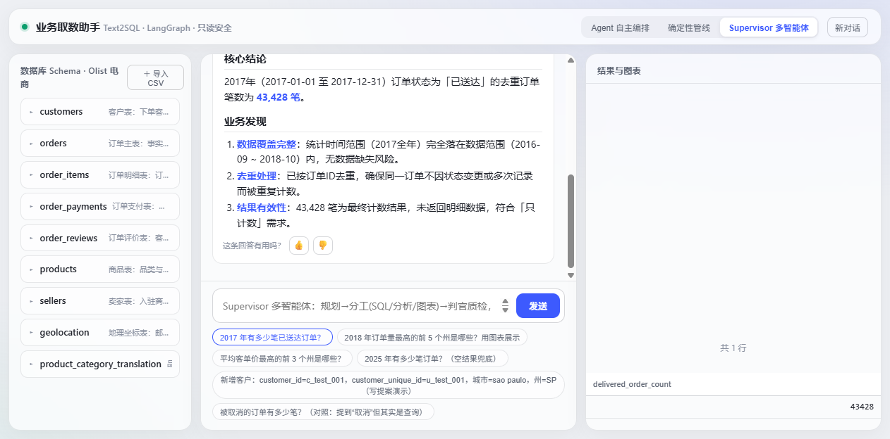
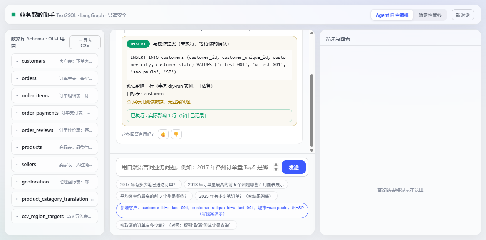

# text2sql-agent — 面向业务取数的数据分析 Agent

> 自然语言 → SQL → 结果 → 图表的对话式取数系统。
> **手写 LangGraph 状态图编排**（禁用 `create_react_agent`），四层只读安全，
> 60 条金标评测集 + 自愈专项，FastAPI SSE 流式 + 玻璃拟态三栏前端。

  

## 它解决什么问题

不会 SQL 的业务人员（运营/产品/管理者）用自然语言直接拿数字，
把「提需求 → 数据组排期 → 等回数」的长链路压缩成 30 秒问答。
业务口径（默认 delivered、客户去重用 customer_unique_id、金额含运费）写死在
system prompt，保证人人问出一致口径。

## 三种编排对照（核心设计）

| | react_graph（S3） | agentic_graph（S4） | supervisor_graph（S8） |
|---|---|---|---|
| 编排哲学 | **确定性管线**：understand→generate→validate→execute 顺序由代码写死 | **LLM 自主编排**：模型每轮输出 tool_calls，图只做「执行→观察→回喂」循环 | **规划-分工-裁决**：Planner 拆解 → 三个子 Agent（黑板共享、messages 隔离）→ Judge 质量门控 |
| 模型角色 | 只负责 generate 一步 | 自主决定调什么工具、调几轮 | 子 Agent 各司其职；Judge 有否决权（fix 打回重做，revision≤2） |
| 适合场景 | 流程固定、可解释性优先 | 开放任务、工具组合多样 | 高质量要求、可接受额外调用成本 |
| 共同护栏 | MAX_STEPS + TOKEN_BUDGET + 四层安全（与编排无关，双保险） | 同左 | 同左 + judge 两层门控（Python 硬门控 + LLM-as-Judge） |

三者都手写 `add_node` / `add_conditional_edges`（禁 prebuilt）。S3/S4 同一套行为用例 8/8 双过。

**S8 双跑对照（DeepSeek-V4.1-Flash，2026-10-16）**：两种编排**都 8/8 全过**（AGNES 时代 supervisor
只有 7/8，唯一失败来自免费额度 429）。真实代价是 **延迟 +56%、成本 +62%**
（agentic ¥0.0278 / supervisor ¥0.0451）——见下方「计量订正」。

> ★ **计量订正（面试会问）**：早期版本写「supervisor token −56%」，那是拿**两个口径不一致的
> 数**相除来的。图内 `state.token_cost` 对 agentic **少算 31.4%**（47,870 vs API 实测 69,855）——
> 根因是 agentic 通过 `bind_tools` 暴露的 `generate_sql` **工具内部自己也调了一次 LLM**
> （`tools/registry.py:111`），**嵌套调用的 token 没进 state**。改用同一口径（直接读 API usage 的
> `CostTracker`）重算：**−9.8%**，不是 −56%。**这个不一致是靠"加一个独立计量"才发现的**——
> 单一计量口径无法自证。详见 `METRICS.md`。
前端「Supervisor 多智能体」按钮可现场演示判官打回循环。



> 上图：顶部编排切换按钮可见当前处于 **Supervisor 多智能体**。结论卡里的「数据覆盖完整 / 去重处理 /
> 结果有效性」三项是子 Agent 分工产出后经判官门控通过的内容——**口径自检写进回答本身**，
> 而不是让用户自己去核对（业务取数最怕的是「数字对了但口径错了」）。

## 实测指标（全部真实跑出，详见 METRICS.md）

| 指标 | 数字 | 说明 |
|---|---|---|
| Few-shot 消融 | 0.600 → **1.000**（+0.4） | Schema 注入 vs +Top-3 few-shot，10 条金标 |
| SQL 生成准确率 | **0.860**（43/50） | 60 条全量评测（6 条安全题除外），AGNES 基线 |
| 端到端结果匹配 | **0.870**（47/54） | 同上 |
| 自愈成功率 | **0.708**（17/24） | 注入 3 类真实执行错误后恢复；**DeepSeek 复跑同为 0.708** |
| 安全拦截 | **6/6** | 恶意请求全拦，无写操作落地 |
| 跨模型复跑 | SQL 0.780 / 端到端 0.796 | DeepSeek-V4.1-Flash 全量 60 条，**实测成本 ¥0.1755、耗时 460s（快 5.8×）**；差异逐条归因见 METRICS（**真实模型差异 0 条**） |
| 成本计量单测 | 24/24 | `tests/test_cost.py`：计价算术 / 缓存命中四种键名 / 峰谷分档 / 熔断；**已做变异验证非空转** |
| 攻击用例 | 17/17 | AST 层单测（越权表/子查询绕过/拼接/OUTFILE） |
| 写路径安全用例 | 18/18 | S9 HITL：三道闸 8 + dry-run 零副作用 3 + commit/审计 2 + CSV 导入 5 |
| Supervisor 离线用例 | 5/5 | S8：FakeLLM 驱动全图（happy path / 判官打回循环 / 安全降级 / 规划纠偏） |
| CTE 白名单用例 | 4/4 | S8 连带修复：WITH 别名不被误杀、不掩盖真越权表 |
| MCP 协议用例 | **12/12** | S7：stdio/http 双传输回环 + 安全不旁路 + 第三方工具动态注册 + **子进程凭据白名单 3 条** |
| 服务层测试 | pytest **110 passed，0 skipped** | 工具双保险 + 安全层 + S9 写路径 + S8 Supervisor + S7 MCP + 场景包 + 成本计量；**换 DeepSeek 后原本"因额度跳过"的 2 条真实 LLM 用例也真的跑起来了**（AGNES 时代长期 81 passed + 2 skipped） |

评测卫生：金标集与 few-shot 库严格错题；金标口径与 system prompt 一致（踩过 3 个评测设计坑）。
性能账本（真实计时/计费，详见 METRICS.md）：S5 全量延迟 mean 44.3s / median 37.0s / p95 101s，
**自愈的延迟代价 = 一次通过 +25%**（50.9s vs 40.7s）。换 DeepSeek-V4.1-Flash 全量复跑：
S5 端到端 **460s vs AGNES 约 2658s（快 5.8×）**、三个评测合计 **约 ¥0.29**（实测，非估算）。

## 库的增删改查（S9：HITL 提案-人审）

读路径让 Agent 自主循环；**写路径永不进自主循环**——模型只有建议权，人有否决权与执行权：

1. 写意图（正则粗筛 + LLM 严格 JSON 判定）→ 生成**提案 SQL**（仅 INSERT/UPDATE/DELETE、表白名单、UPDATE/DELETE 必带 WHERE）
2. **事务 dry-run**：BEGIN→执行→SELECT changes()→ROLLBACK，零副作用拿到精确影响行数 + 「将被改动的行」取证样本——dry-run 还能提前抓住约束违约（如 NOT NULL），拦截后转读路径兜底
3. SSE 推 `proposal` 事件 → 前端审批卡（SQL / 影响行数 / 取证样本 / 风险说明）→ 人点「确认执行 / 拒绝」
4. `/api/confirm` 复检三道闸 → **独立写凭据**（SQLite 去 mode=ro；MySQL 形态 agent_rw 账号）事务执行 → `write_audit.jsonl` 审计留痕

数据接入：左栏「＋ 导入CSV」→ 表名/列名清洗 + 类型推断 + 行数质检 → **动态注册进白名单与 Schema 注入**（重启自动恢复），Agent 下一句即可查询新表。



> 上图一次演示里同时可见两个状态：**提案未执行**（INSERT 卡 + 事务 dry-run 算出的「预估影响 1 行」
> + 目标表白名单校验 + 风险说明）与**人审通过后**（「已执行·实际影响 1 行（审计已记录）」）。
> 左栏底部的 `csv_region_targets` 就是 CSV 导入后**动态注册**的新表。

## MCP 对外开放 + 第三方工具接入（S7）

能力开放遵循一条原则：**MCP 只是协议外壳，安全语义不变**——

- **Server**（`src/mcp_server.py`，FastMCP）：把 generate_sql / execute_readonly_sql /
  compute_metric / render_chart 四个工具按 MCP 暴露，实现层复用 `src/tools/registry`
  同一份代码（不是绕过安全的副本）。支持 stdio 与 streamable-http 双传输：
  `python src/mcp_server.py --http 8600`
- **Client**（`src/mcp_client.py`）：后台事件循环 + AsyncExitStack 保活连接；
  任何 MCP server 一行接入：
  ```python
  from src.mcp_client import enable_mcp_tools
  enable_mcp_tools([{"name": "ext", "transport": "http", "url": "http://127.0.0.1:8610/mcp"}])
  # 发现 → inputSchema 动态转 Pydantic → register_external_tool → Agent 下一轮可见
  ```
- 经 MCP 调 `DROP TABLE` / 查白名单外表**照样被四层安全拦截**；
  与原生同名的第三方工具被跳过（原生优先），新工具经 Pydantic 校验通道 dispatch（无旁路）。

**子进程凭据：不做全量环境透传，走显式白名单**（`src/mcp_client.py::_MCP_ENV_PASSTHROUGH`）

stdio 子进程的环境**不是**父进程 `os.environ` 的复制——MCP SDK 只透传
`get_default_environment()` 的白名单（本机实测仅 12 个变量：`PATH` / `APPDATA` / `TEMP` /
`USERNAME` …，**零凭据**）。于是「父进程明明配好了 `DEEPSEEK_API_KEY`，子进程却报
`Missing credentials`」——根因在传参层，不在密钥配置层。

修法刻意**不做 `**os.environ` 全量透传**：那等于把父进程所有密钥（数据库口令、云厂商
token、第三方 key）一并塞进一个我们并未逐行审计过的子进程，是用「修好了」换「泄露面无限大」。
正确姿势是**显式白名单**——子进程要自建 LLM 与只读连库，就只给它这两类凭据；写库口令
`agent_rw` 刻意不在名单内。`tests/test_mcp.py` 有 3 条**零 LLM 消耗**的用例钉住这条边界
（且已做变异验证：还原成「只返回 SDK 基线」时断言必红，非空转）。

## 业务外壳可插拔：场景包（Scenario Pack）

引擎与业务口径**解耦**——把「随业务变化的口径级参数」收进一个不可变数据类，换场景不改图/安全/工具一行代码。

| | |
|---|---|
| 定义 | `src/scenarios/base.py::ScenarioProfile`（frozen dataclass，10 个字段） |
| 内置 | `src/scenarios/olist.py::OLIST`（电商 / SQLite / 数据范围 2016-09~2018-10 / 默认状态 `delivered` / 去重键 `customer_unique_id` / 币种 BRL / 业务表枚举） |
| 消费点 | **5 处**：`agent/nodes.py`、`agentic_graph.py`、`supervisor_graph.py`、`agent/prompting.py`、`api/server.py` |
| 契约测试 | `tests/test_scenario.py`（6 用例，含**医疗场景换装演示**：换成 patient 表 + 挂号状态口径，断言 prompt 随之变化） |

**字段取舍原则**：只收「多个 prompt 共用、且随业务变化」的值；单处使用或纯模板措辞留在各 prompt 里——避免过度抽象。

**为什么值得做**：口径散落在 5 个 prompt 里时，「改一个业务口径」= 改 5 个地方且**必然漏改**；
而漏改的后果在评测上是**区分度丢失**——金标口径与 prompt 口径不一致时，模型「遵守规则」却被判错
（S5 踩过这个坑）。收进 frozen dataclass 后改口径只改一个文件，并由测试钉住
「改 profile → 全部 prompt 同步变化」这条性质。

## 架构

```
用户问题
   │
   ▼
FastAPI /api/query (SSE)                     ┌────────────────────────┐
   │  producer thread + queue                │ react_graph（确定性管线）│
   ▼                                        │   understand → generate │
┌──────────────┐    ┌──────────────────┐    │   → validate → execute  │
│ 四层安全层    │───▶│ Olist 9 表        │    │   → self_correct ↺     │
│ 只读/白名单/  │    │ SQLite dev 库     │◀───┤                        │
│ LIMIT/超时   │    │ (MySQL 就绪:      │    │ agentic_graph（LLM 自主）│
└──────────────┘    │  agent_ro 只读)   │    │   agent ⇄ tools 循环    │
                    └──────────────────┘    │   → respond             │
                                            └────────────────────────┘
   事件: thought / sql / result / chart / answer / error
   ▼
三栏前端：Schema 树 │ 对话（SQL 折叠/反馈）│ 结果表 + ECharts
```

## 快速开始

```bash
# 1. 环境（Python 3.12）
python -m venv .venv && .venv/Scripts/activate    # Windows
pip install -r requirements.txt

# 2. 数据入库（Olist 公开数据集 9 表）
python scripts/init_db.py
#    建库后会自动刷新 data/schema.md（给人读的 Schema 文档，随仓库提交）
#    单独刷新文档（不重建库）：python scripts/init_db.py --dump-schema

# 3. 配置 LLM（.env）
#    AGNES_API_KEY=...   （或 DEEPSEEK_API_KEY，config 留有备用位）

# 4. 起 API 服务（8501）
python scripts/run_api.py
# 打开 http://127.0.0.1:8501

# 5. 跑评测
python evals/run_eval_s5.py          # 60 条全量
python evals/run_selfheal_eval.py    # 自愈专项
python -m pytest -q                  # 单测
```

## 代码导读（推荐阅读顺序）

> 详细版（每文件的内容/作用/模块关系/阅读要点 + 整体 pipeline 图 + 术语表）见
> **[ARCHITECTURE.md](ARCHITECTURE.md)**；下表是速览版。

| 顺序 | 文件 | 知识点 |
|---|---|---|
| 1 | `src/core/config.py` | pydantic-settings；SQLite/MySQL URL 抽象（库无关设计） |
| 2 | `src/db/connect.py` | SQLAlchemy 双引擎；SQLite `mode=ro` creator 注入（只读兜底） |
| 3 | `src/safety/validator.py` | **四层安全**：sqlparse AST 白名单 / LIMIT 注入 / progress_handler 超时 |
| 4 | `src/agent/state.py` | LangGraph State 定义（Annotated reducer） |
| 5 | `src/agent/react_graph.py` | **手写确定性状态图**（对照 prebuilt 的差异） |
| 6 | `src/agent/agentic_graph.py` | **手写 ReAct 工具循环**：bind_tools → 条件边 → 观察回喂 |
| 7 | `src/tools/registry.py` | Function Calling 工具注册：JSON Schema（软约束）+ Pydantic（硬校验）双保险 |
| 8 | `src/agent/prompting.py` + `fewshot.py` | Schema 注入 / few-shot 加权检索（bigram TF，CPU 可部署取舍） |
| 9 | `src/api/server.py` | FastAPI + SSE 真流式（producer thread + queue）；事件归一化；输出净化 |
| 10 | `web/index.html` | 原生 JS 三栏布局；SSE 消费；markdown 逐行渲染；ECharts |
| 11 | `src/mcp_server.py` + `src/mcp_client.py` | **MCP 双向**：FastMCP 工具开放（复用 registry）+ AsyncExitStack 客户端 + 动态注册 |
| 12 | `src/scenarios/base.py` + `olist.py` | **场景包**：口径级参数收进 frozen dataclass，5 个消费点零改动换业务外壳 |
| 13 | `evals/run_eval_s5.py` | 评测框架：金标比对 / 断点续跑 / 结果归因 |
| 14 | `METRICS.md` | 全部指标数字与踩坑记录（面试素材库） |

## 已知边界与生产化路线（诚实清单）

数据层当前为开发期一次性导入的静态快照；生产落地还需：
企业数据链路（ETL/CDC → 分析从库，Agent 只当读者）、SSO/RBAC 行列权限与审计、
PII 脱敏、schema 变更感知与 schema linking、并发/缓存/限流、Docker 部署。

**写路径的「提案-人审-执行」已实现**（S9，走 SSE `proposal` 事件 + `/api/confirm` 复检三道闸），
剩余的是更成熟的形态：用 LangGraph `interrupt` 支持**可中断/可恢复**的长事务审批、
并发场景下的提案状态管理（当前提案活在单次请求的生命周期内）。
详见 METRICS.md 与构建历程图。

**已知记账缺陷（未修，已定位）**：agentic 图通过 `bind_tools` 暴露的 `generate_sql` 工具
内部自己也调一次 LLM（`tools/registry.py:111`），**这类嵌套调用的 token 不会进 `state.token_cost`**
（实测少算 31.4%）。当前以 CostTracker（读 API usage）为跨编排比较的权威口径绕开了它；
若要根治，应让工具复用节点实现并把嵌套用量回写 state——同时也能顺带消掉「工具版 SQL 生成
与节点版提示词构建的重复」。

## License

MIT
